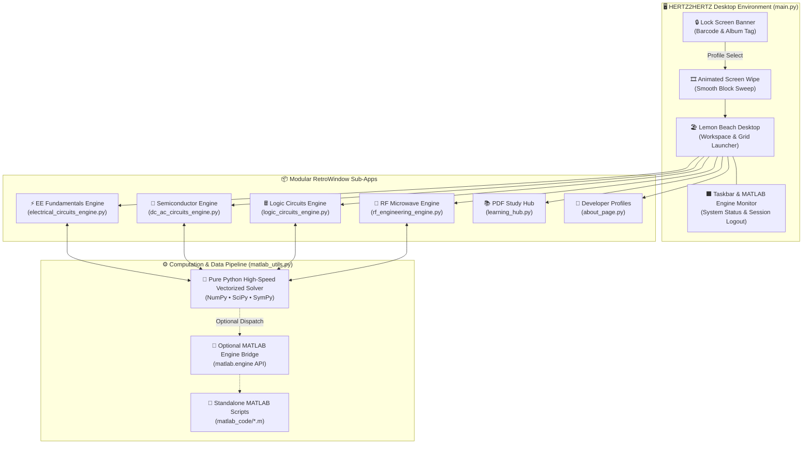

# 🍋 HERTZ2HERTZ — Numerical Analysis & Circuit Simulation Lab
### *Lemon Beach Edition • Neobrutalist Desktop Operating Environment*

<div align="center">

```
  _  _ ___ ___ _____ ___ ___ _  _ ___ ___ _____ ___ 
 | || | __| _ \_   _|_  ) _ \ || | __| _ \_   _|_  )
 | __ | _||   / | |  / /|   / __ | _||   / | |  / / 
 |_||_|___|_|_\ |_| /___|_|_\_||_|___|_|_\ |_| /___|
          ~ L E M O N   B E A C H   E D I T I O N ~  
```

[](https://www.python.org/)
[](https://customtkinter.tomschimansky.com/)
[](https://www.mathworks.com/products/matlab.html)
[](https://numpy.org/)
[](https://en.wikipedia.org/wiki/Neobrutalism)
[](https://national-u.edu.ph/)

*A complete, multi-domain computer engineering workbench combining high-precision circuit mathematics, semiconductor physics, digital logic, and RF microwave equations inside a high-contrast Neobrutalist desktop operating system.*

[⚡ Features](#-features-overview) • [📐 Math & Engines](#-in-depth-engine-modules) • [🏗️ Architecture](#%EF%B8%8F-system-architecture) • [🚀 Quickstart](#-installation--quickstart) • [📁 Structure](#-project-structure) • [👥 Credits](#-developers--academic-credits)

---

</div>

> [!NOTE]
> **Dual Engine Architecture**: **HERTZ2HERTZ** is designed to run in **100% Pure Python** out-of-the-box (using vectorized NumPy/SciPy formulations) with **zero installation overhead**. It also includes optional seamless hooks to the official **MathWorks MATLAB Engine API** and a dedicated directory of standalone `.m` scripts!

---

## 📸 Visual Aesthetic & UI Philosophy

HERTZ2HERTZ breaks away from boring, monochromatic engineering calculators. It draws inspiration from a **K-Pop Summer Photobook ("Lemon Beach")** blended with **Modern Web Neobrutalism**:
* 🟡 **Sunshine Lemon Yellow (`#FEF08A`)** & 🍊 **Citrus Sunset Orange (`#FF6B00`)**
* 🌊 **Summer Sky Cyan (`#BAE6FD`)** & 🌿 **Seafoam Mint Green (`#A7F3D0`)**
* 🌸 **Pastel Flamingo Pink (`#FBCFE8`)** & 🏖️ **Warm Sand White (`#FEFCE8`)**
* ⬛ **High-Contrast 4px–8px Solid Black Borders** (`#000000`)
* 📐 **Zero Corner Radii (`corner_radius=0`)** with stark, tactile drop shadows (6px offset)
* 🎞️ **Cinematic Wipe Transition**: Screen changes feature a custom directional block sweep animation!

---

## ⚡ Features Overview

| Feature Module | Core Capabilities | Underlying Math / Tech |
| :--- | :--- | :--- |
| **⚡ EE Fundamentals** | Ohm's law, DC power, 5-branch series/parallel networks, multi-loop KVL matrix solver, AC steady-state RLC phasor analysis. | $[R][I] = [V]$ Gaussian Mesh Inversion, Dual-axis Matplotlib Oscilloscope. |
| **🌊 Semiconductor Electronics** | Shockley diode models, dynamic AC/DC resistance, rectifiers, clippers, clampers, LED limiters, BJT biasing & load lines, $r_e$ small-signal, FET transconductance. | Non-linear root-finding, vectorized wave-shaping, 3D Matplotlib transistor output surfaces. |
| **🖩 Logic & Digital Circuits** | Radix conversions, 2's complement, parity generators, 7 IEEE gates, K-Map simplification, custom Boolean expression truth tables, combinational blocks & flip-flops. | Quine-McCluskey minimization, Boolean AST parser, discrete state excitation tables. |
| **📡 RF & Microwave** | Conformal Smith Chart visualizer, VSWR, Reflection coefficient ($|\Gamma|$), Return Loss ($RL$), $\lambda/4$ matching transformers, Friis link budgets. | Conformal bilinear transformation $\Gamma = \frac{z-1}{z+1}$, high-frequency Friis path loss. |
| **📚 Study Hub** | In-app syllabus browser & PDF slide reader with 2x anti-aliased rendering and page controls. | `PyMuPDF` (`fitz`) embedding directly into CustomTkinter canvas. |
| **👥 About & Profiles** | Neobrutalist developer ID cards, project architecture specs, and system telemetry logs. | High-res PIL image scaling, scrollable canvas layout. |
| **💾 Session Report Exporter** | Timestamped session logger capturing all calculation histories, matrix outputs, and circuit states. | Formatted `.txt` report generator ready for lab submissions. |

---

## 🏗️ System Architecture



---

## 📐 In-Depth Engine Modules

### 1. ⚡ Electrical Circuits Engine (`electrical_circuits_engine.py`)
Covers the core curriculum of DC Circuit Analysis and AC Fundamentals:
* **Ohm's Law & DC Power**: Computes Voltage ($V$), Current ($I$), Resistance ($R$), and Power ($P = VI = I^2R = \frac{V^2}{R}$) with live circuit schematics drawn via Tkinter Canvas vectors.
* **Series & Parallel Networks**: Calculates equivalent resistance ($R_{eq}$), capacitance ($C_{eq}$), and inductance ($L_{eq}$) across up to 5 parallel or series branches with individual current/voltage divider distributions:
  $$\frac{1}{R_{eq}} = \sum_{k=1}^n \frac{1}{R_k}, \quad C_{eq} = \sum_{k=1}^n C_k$$
* **Multi-Loop Kirchhoff's Voltage Law (KVL)**: Implements a 2-loop and 3-loop mesh current matrix solver using Gaussian elimination ($[R][I] = [V] \implies [I] = [R]^{-1}[V]$), printing loop currents $I_1, I_2, I_3$ and branch dissipation.
* **AC Series R-L-C & Oscilloscope**: Dynamic steady-state AC solver calculating inductive reactance $X_L = 2\pi f L$, capacitive reactance $X_C = \frac{1}{2\pi f C}$, impedance magnitude $|Z| = \sqrt{R^2 + (X_L - X_C)^2}$, and phase angle $\theta = \arctan\left(\frac{X_L - X_C}{R}\right)$. Renders dual-trace sinusoidal waveforms for voltage $v(t)$ and current $i(t)$ with phase lead/lag.

---

### 2. 🌊 Semiconductor Electronics Engine (`dc_ac_circuits_engine.py`)
Comprehensive electronic circuit analysis with embedded real-time Matplotlib plots:
* **Diode Shockley Dynamic Model**:
  $$I_D = I_S \left( e^{\frac{V_D}{n V_T}} - 1 \right)$$
  Calculates DC static resistance ($R_{DC} = \frac{V_D}{I_D}$) and AC dynamic resistance ($r_{ac} = \frac{n V_T}{I_D + I_S}$), dynamically plotting the tangent slope ($r_d$) and secant line ($R_D$) over the non-linear I-V curve.
* **Diode Waveform Applications**:
  * **Half-Wave Rectifier**: $V_{out}(t) = \max(0, V_{in}(t) - V_D)$, $V_{DC} = \frac{V_m - V_D}{\pi}$, $V_{RMS} = \frac{V_m - V_D}{2}$.
  * **Full-Wave Bridge (4 Diodes)**: $V_{out}(t) = \max(0, |V_{in}(t)| - 2V_D)$, $V_{DC} = \frac{2(V_m - 2V_D)}{\pi}$, $V_{RMS} = \frac{V_m - 2V_D}{\sqrt{2}}$.
  * **Biased Positive & Negative Clippers**: Truncates input sinusoid above/below clipping thresholds $V_{clip} = V_{bias} \pm V_D$.
  * **Biased Positive & Negative Clampers**: Level-shifts AC signals by $V_{shift} = \pm(V_i - V_D \pm V_{bias})$ preserving full peak-to-peak amplitude $2V_i$.
  * **LED Ballast Resistor Limiter**: Calculates current-limiting resistor $R_{lim} = \frac{V_{CC} - V_f}{I_F}$ and wattage.
* **BJT Fundamentals & Four Biasing Topologies**:
  * Evaluates Fixed Bias, Voltage Divider Bias, Emitter-Stabilized Bias, and Collector Feedback Bias.
  * Solves Quiescent Operating Point ($Q$-point: $I_{CQ}, V_{CEQ}$) and renders the DC Load Line from Cutoff ($V_{CE} = V_{CC}$) to Saturation ($I_{C(sat)}$).
* **BJT AC Small-Signal ($r_e$ Model)**: Solves $r_e = \frac{26\text{ mV}}{I_E}$, input impedance $Z_{in}$, output impedance $Z_{out}$, and unloaded/loaded AC voltage gain $A_v$.
* **Field-Effect Transistors (FET) & CMOS**:
  * **JFET / D-MOSFET**: Shockley equation $I_D = I_{DSS} \left(1 - \frac{V_{GS}}{V_P}\right)^2$ with transconductance $g_m = g_{m0}\left(1 - \frac{V_{GS}}{V_P}\right)$.
  * **E-MOSFET Square-Law Model**: $I_D = k(V_{GS} - V_{th})^2$ and $g_m = 2k(V_{GS} - V_{th})$.
* **3D Transistor Surface Engine**: Renders a full 3D interactive mesh surface ($I_C$ vs $V_{CE}$ vs $I_B$) using Matplotlib 3D projections with cursor rotation.

---

### 3. 🖩 Logic & Digital Circuits Engine (`logic_circuits_engine.py`)
Essential digital electronics workstation with custom ASCII visual tables:
* **Radix & Number Systems**: Real-time conversions between Binary, Octal, Decimal, and Hexadecimal, including signed two's complement and Even/Odd parity checking/generation.
* **Logic Gates Lab**: Interactive visual vector canvas drawing IEEE standard logic gates (AND, OR, NOT, NAND, NOR, XOR, XNOR) alongside auto-generated truth tables.
* **K-Map Minimizer**: 2, 3, and 4-variable Karnaugh Map solver with Gray code coordinate grids ($00, 01, 11, 10$) and automated Boolean expression simplification into minimal Sum of Products (SOP).
* **Boolean Expression Evaluator**: Dynamic parser evaluating complex logical strings (e.g. `(A AND B) OR (NOT C)`) into full multi-variable truth tables with variable auto-detection.
* **Combinational Circuits**: Dedicated tabs for Half Adder, Full Adder, Half Subtractor, Full Subtractor, 2-to-1 MUX, 4-to-1 MUX, and 2-to-4 Decoder.
* **Sequential Logic & Flip-Flops**: Detailed excitation and state transition tables for SR Latch, D Latch, D Flip-Flop, T Flip-Flop, JK Flip-Flop, and Master-Slave JK with rising clock edge indicators (`CLK ↑`).

---

### 4. 📡 RF & Microwave Engineering Engine (`rf_engineering_engine.py`)
High-frequency transmission line solver:
* **Interactive Conformal Smith Chart**: Conformal mapping of complex normalized impedance $z = r + jx$ onto the reflection plane:
  $$\Gamma = \frac{z - 1}{z + 1}$$
  Plots constant resistance circles ($r = 0, 0.5, 1.0, 2.0, 5.0$) and constant reactance arcs ($x = \pm 0.5, \pm 1.0, \pm 2.0$) with load impedance probe marker.
* **Reflection & VSWR**: Computes reflection coefficient magnitude $|\Gamma|$, Voltage Standing Wave Ratio ($VSWR$), and Return Loss ($RL$ in dB) from either line impedances ($Z_L, Z_0$) or forward/reflected power measurements:
  $$|\Gamma| = \sqrt{\frac{P_{ref}}{P_{fwd}}} = \left|\frac{Z_L - Z_0}{Z_L + Z_0}\right|, \quad VSWR = \frac{1 + |\Gamma|}{1 - |\Gamma|}, \quad RL = -20\log_{10}(|\Gamma|)$$
* **$\lambda/4$ Quarter-Wave Transformer**: Calculates required transformer impedance $Z_1 = \sqrt{Z_0 Z_L}$ for zero-reflection matching.
* **Friis Transmission Link Budget**: Line-of-sight wireless path budget:
  $$P_r(\text{dBm}) = P_t(\text{dBm}) + G_t(\text{dBi}) + G_r(\text{dBi}) - \text{PathLoss}(\text{dB})$$

---

### 5. 📚 Study Hub & PDF Syllabus Browser (`learning_hub.py`)
An embedded courseware reader powered by **PyMuPDF (`fitz`)**:
* Houses official lecture presentations and study sets directly inside the application under `pdfs/electronics/` and `pdfs/logic/`.
* Renders lecture slides at **2x anti-aliased resolution** with previous/next page navigation, page counter, and topic selection.

---

### 6. 👥 Developer Profiles & Credits (`about_page.py`)
* Neobrutalist photo ID badges showcasing project creators from **National University Laguna (NU Laguna)**.
* Includes system architecture details, engineering role distribution, and pure-Python/MATLAB engine specifications.

---

## 📁 Project Structure

```text
MATLAB CALCULATOR/
├── assets/                               # UI Graphics, Logos & Developer Photos
│   ├── dev1.png                          # Lead Engineer Avatar
│   ├── steven.png                        # Co-Designer Profile Photo
│   ├── user_uploaded_dev.jpg             # Lead Engineer Profile Photo
│   ├── engine_photo.png                  # Engine Architecture Photo
│   ├── hertz_concept.png                 # Concept Graphic
│   └── lemontang_logo.png                # Retro Summer Branding Logo
│
├── matlab_code/                          # Standalone MATLAB Reference Scripts (.m)
│   ├── diode_calc.m                      # Shockley diode & resistance equations
│   ├── ee_calc.m                         # Ohm's law, mesh KVL, and AC RLC solver
│   ├── kvl_solver.m                      # Multi-loop matrix linear algebra solver
│   ├── logic_calc.m                      # Truth tables & logic gate algorithms
│   ├── ohms_law.m                        # Pure MATLAB Ohm's law script
│   ├── rf_calc.m                         # Smith chart & VSWR equations
│   ├── semiconductor_calc.m              # BJT/FET biasing & non-linear solvers
│   └── series_parallel.m                 # Resistor network reduction script
│
├── pdfs/                                 # Integrated Course Syllabi & Lecture Slides
│   ├── electronics/                      # ECELXC30 Semiconductor Lecture PDFs (Topics 1-8)
│   └── logic/                            # Logic Circuits 1 Coursework (Lessons 1-18)
│
├── about_page.py                         # Developer ID Cards & About Page
├── dc_ac_circuits_engine.py              # Semiconductor Electronics & Diode/BJT/FET Engine
├── electrical_circuits_engine.py         # EE Fundamentals, KVL Matrix & AC Engine
├── learning_hub.py                       # PyMuPDF Integrated Syllabus Reader
├── logic_circuits_engine.py              # Digital Logic, K-Map & Boolean Engine
├── main.py                               # Application Entrypoint & Neobrutalist Desktop OS
├── matlab_utils.py                       # Pure Python Vectorized Engine & MATLAB Dispatcher
├── practical_applications.py             # Real-World Engineering Context & Examples
├── requirements.txt                      # PIP Dependencies Specification
├── retro_ui.py                           # Neobrutalist Window, Color Palette & UI Widgets
└── rf_engineering_engine.py              # Smith Chart, VSWR & Friis Link Budget Engine
```

---

## 🚀 Installation & Quickstart

### 1. Prerequisites
* **Python 3.10 to 3.12** installed on your system.
* *(Optional)* **MATLAB (R2024b to R2026b)** if you wish to run standalone `.m` scripts in the MathWorks environment or link via `matlabengine`.

### 2. Clone the Repository
```bash
git clone https://github.com/your-username/hertz2hertz-calculator.git
cd hertz2hertz-calculator
```

### 3. Create a Virtual Environment *(Recommended)*
```bash
# Windows (PowerShell)
python -m venv venv
.\venv\Scripts\Activate.ps1

# macOS / Linux
python3 -m venv venv
source venv/bin/activate
```

### 4. Install Dependencies
```bash
pip install -r requirements.txt
```

### 5. Launch the Desktop OS
```bash
python main.py
```

> [!TIP]
> **Need a Report for your Lab Class?**
> Click the green **`[EXPORT LOG]`** button on the top toolbar inside any engine to automatically export a timestamped report file (`EE_Circuits_Report_YYYYMMDD_HHMMSS.txt`) containing all inputs, calculations, and mathematical proofs!

---

## 🧪 Running Standalone MATLAB Scripts

If you want to run calculations directly inside **MATLAB**:
1. Open MATLAB and navigate to the project's `matlab_code/` folder:
   ```matlab
   cd('path/to/MATLAB CALCULATOR/matlab_code')
   ```
2. Run any standalone computation script:
   ```matlab
   ee_calc          % Solves Ohm's law, 3-loop KVL, and AC RLC
   semiconductor_calc % Computes Diode, BJT DC Biasing, and FET transconductance
   rf_calc          % Computes VSWR, Smith chart reflection, and Link budget
   logic_calc       % Demonstrates truth tables and logic operations
   ```

---

## 📖 Variable & Formula Quick Reference

<details>
<summary><b>🔍 Click to expand the full formula reference table</b></summary>

### Electrical & Circuit Analysis
* **Ohm's Law**: $V = I \times R, \quad I = \frac{V}{R}, \quad R = \frac{V}{I}$
* **Electric Power**: $P = V \times I = I^2 R = \frac{V^2}{R}$
* **AC Impedance**: $|Z| = \sqrt{R^2 + (X_L - X_C)^2}, \quad \theta = \arctan\left(\frac{X_L - X_C}{R}\right)$
* **Mesh Analysis**: $[R_{mesh}] [I_{loop}] = [V_{source}]$

### Diodes & Wave-Shaping
* **Shockley Diode Equation**: $I_D = I_S \left(e^{\frac{V_D}{n V_T}} - 1\right)$ ($V_T \approx 26\text{ mV}$)
* **Diode Resistances**: $R_{DC} = \frac{V_D}{I_D}, \quad r_{ac} = \frac{n V_T}{I_D + I_S}$
* **Half-Wave Rectifier**: $V_{DC} = \frac{V_m - V_D}{\pi}, \quad V_{RMS} = \frac{V_m - V_D}{2}$
* **Full-Wave Bridge**: $V_{DC} = \frac{2(V_m - 2V_D)}{\pi}, \quad V_{RMS} = \frac{V_m - 2V_D}{\sqrt{2}}$
* **LED Current Limiter**: $R_{lim} = \frac{V_{CC} - V_f}{I_F}$

### Transistors (BJT & FET)
* **BJT Current Relations**: $I_E = I_B + I_C, \quad \beta = \frac{I_C}{I_B}, \quad \alpha = \frac{\beta}{\beta + 1}$
* **Voltage Divider Bias**: $V_B = V_{CC} \frac{R_2}{R_1 + R_2}, \quad V_E = V_B - 0.7\text{ V}, \quad I_E = \frac{V_E}{R_E}$
* **BJT AC Small-Signal ($r_e$)**: $r_e = \frac{26\text{ mV}}{I_E}, \quad Z_{in} \approx R_B \parallel (\beta r_e), \quad A_v = -\frac{R_C \parallel R_L}{r_e}$
* **JFET / D-MOSFET**: $I_D = I_{DSS} \left(1 - \frac{V_{GS}}{V_P}\right)^2, \quad g_m = \frac{2 I_{DSS}}{|V_P|} \left(1 - \frac{V_{GS}}{V_P}\right)$
* **E-MOSFET Square Law**: $I_D = k(V_{GS} - V_{th})^2, \quad g_m = 2k(V_{GS} - V_{th})$

### RF Microwave & Transmission Lines
* **Reflection Coefficient**: $|\Gamma| = \left|\frac{Z_L - Z_0}{Z_L + Z_0}\right| = \sqrt{\frac{P_{ref}}{P_{fwd}}}$
* **VSWR & Return Loss**: $VSWR = \frac{1 + |\Gamma|}{1 - |\Gamma|}, \quad RL = -20\log_{10}(|\Gamma|) \text{ dB}$
* **Quarter-Wave Match**: $Z_1 = \sqrt{Z_0 Z_L}$
* **Friis Link Budget**: $P_r(\text{dBm}) = P_t(\text{dBm}) + G_t(\text{dBi}) + G_r(\text{dBi}) - \text{PathLoss}(\text{dB})$

</details>

---

## 👥 Developers & Academic Credits

Developed as part of the **Computer Engineering Curriculum (BSCPE)** at **National University Laguna**:

<div align="center">

| Developer | Academic Role | System Responsibility |
| :---: | :---: | :---: |
| **Ivan Lawrence F. Gonzales** | **Lead Software Engineer**<br/>*System Architect* | MATLAB Engine Integration, KVL Matrix Inversion, Shockley Diode Models, Logic Minimization, Math Engine Core |
| **Steven Lo Nieva** | **Co UI / UX Designer**<br/>*Creatives & Visuals* | Neobrutalism UI Design, Lemon Beach Palette, Animated Screen Transitions, Interactive SVG/Canvas Vectors |

**Course / Section**: `BSCPE241B` • **Academic Year**: 2026 • **Status**: `VERIFIED [/]`

</div>

---

## 📄 License & Intellectual Property

This project was developed for educational and engineering research purposes under the **MIT License**. Feel free to fork, expand, and adapt it for university coursework, lab simulations, or numerical computing benchmarks.

<div align="center">

```
  ╔═══════════════════════════════════════════════════════════════╗
  ║    HERTZ2HERTZ NUMERICAL ANALYSIS & CIRCUIT SIMULATION LAB    ║
  ║             STAY REFRESHED • STAY CALCULATING 🍋             ║
  ╚═══════════════════════════════════════════════════════════════╝
```

**[⬆ Back to Top](#-hertz2hertz--numerical-analysis--circuit-simulation-lab)**

</div>

